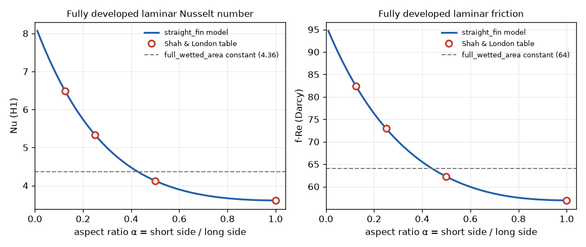
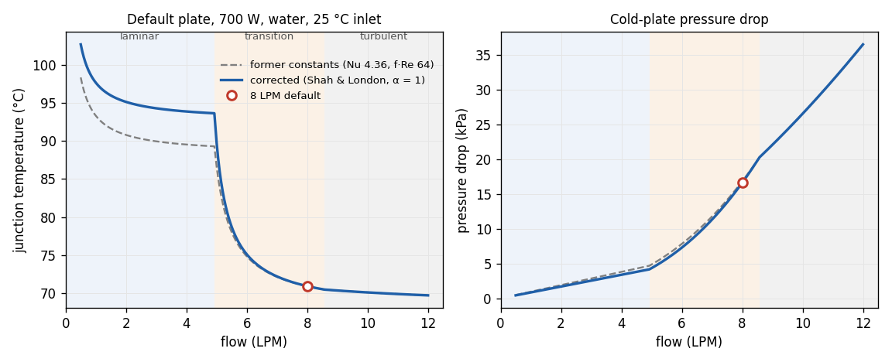

# Model fidelity results: reference case

What the model fidelity track (`docs/work-plan.md`) changed, and what the public chips look like
at a realistic flow per kW once it has. Every number below is printed by
`python examples/reference_case.py`; the figures are drawn by `python examples/make_figures.py`.
These are screening estimates from a 1D model, not measured results.

## What was wrong

Two issues in the convection model, both fixed before this rerun:

- **Circular-tube laminar constants (P1, P2; pull requests 56 and 57).** Laminar flow used
  Nu = 4.36 and f·Re = 64, the values for a round tube, at every channel aspect ratio. Both channel
  models now use the Shah & London (1978) rectangular-duct forms at the channel aspect ratio
  (for a square channel, Nu 3.608 and f·Re 56.908).
- **No fin efficiency (P1).** The default `full_wetted_area` model treats the whole wetted
  perimeter as if it were at base temperature. The optional `straight_fin` model treats the walls
  between channels as fins with adiabatic-tip efficiency and an adiabatic cover
  (`docs/physics.md` Section I).

## Reference case

Water at 35 °C inlet, default package resistances (`R_jc` 0.04 K/W, `R_tim` 0.02 K/W), chip data
from `examples/real_chip_benchmarks.py` unchanged. Three configurations per chip:

- **A:** default plate (40 channels, 1 × 1 × 80 mm), 8 LPM, the repo's historical default flow.
- **B:** default plate at 1.5 LPM per kW of TDP, the reference flow.
- **C:** reference straight-fin plate at the same 1.5 LPM/kW: 76 channels, 0.39 mm wide, 0.39 mm
  fins, 3.75 mm tall, 60 mm long, 2 mm copper base. These dimensions are the screened design from
  the companion `thermal-design-loop` study.

| Chip | TDP (W) | Limit (°C) | Cfg | Flow (LPM) | Tj (°C) | Margin (°C) | ΔP (kPa) | Pump (W) | Re | Regime |
|---|---:|---:|---|---:|---:|---:|---:|---:|---:|---|
| H100 SXM | 700 | 83 | A | 8.00 | 80.9 | 2.1 | 16.59 | 4.423 | 3734 | transitional |
| H100 SXM | 700 | 83 | B | 1.05 | 107.4 | -24.4 | 0.89 | 0.031 | 490 | laminar |
| H100 SXM | 700 | 83 | C | 1.05 | 87.3 | -4.3 | 0.71 | 0.025 | 125 | laminar |
| B200 (NVL72) | 1200 | 75 | A | 8.00 | 113.7 | -38.7 | 16.59 | 4.423 | 3734 | transitional |
| B200 (NVL72) | 1200 | 75 | B | 1.80 | 155.7 | -80.7 | 1.52 | 0.091 | 840 | laminar |
| B200 (NVL72) | 1200 | 75 | C | 1.80 | 121.2 | -46.2 | 1.22 | 0.073 | 214 | laminar |
| MI300X | 750 | 85 | A | 8.00 | 84.2 | 0.8 | 16.59 | 4.423 | 3734 | transitional |
| MI300X | 750 | 85 | B | 1.12 | 112.2 | -27.2 | 0.95 | 0.036 | 525 | laminar |
| MI300X | 750 | 85 | C | 1.12 | 90.7 | -5.7 | 0.76 | 0.029 | 134 | laminar |
| Gaudi 3 OAM (air) | 900 | 85 | A | 8.00 | 94.0 | -9.0 | 16.59 | 4.423 | 3734 | transitional |
| Gaudi 3 OAM (air) | 900 | 85 | B | 1.35 | 126.7 | -41.7 | 1.14 | 0.051 | 630 | laminar |
| Gaudi 3 OAM (air) | 900 | 85 | C | 1.35 | 100.9 | -15.9 | 0.91 | 0.041 | 160 | laminar |
| Gaudi 3 OAM (liquid) | 1200 | 85 | A | 8.00 | 113.7 | -28.7 | 16.59 | 4.423 | 3734 | transitional |
| Gaudi 3 OAM (liquid) | 1200 | 85 | B | 1.80 | 155.7 | -70.7 | 1.52 | 0.091 | 840 | laminar |
| Gaudi 3 OAM (liquid) | 1200 | 85 | C | 1.80 | 121.2 | -36.2 | 1.22 | 0.073 | 214 | laminar |

Minimum flow that meets each chip's limit (margin 0, search 0.2 to 30 LPM):

| Chip | Plate | Minimum flow (LPM) | ΔP at that flow (kPa) | Regime |
|---|---|---:|---:|---|
| H100 SXM | default | 6.607 | 9.58 | transitional |
| H100 SXM | straight-fin | 9.772 | 6.61 | laminar |
| B200 (NVL72) | default | no passing point in 0.2 to 30 LPM | | |
| B200 (NVL72) | straight-fin | no passing point in 0.2 to 30 LPM | | |
| MI300X | default | 7.331 | 12.90 | transitional |
| MI300X | straight-fin | 20.789 | 15.21 | transitional |
| Gaudi 3 OAM (air) | default | no passing point in 0.2 to 30 LPM | | |
| Gaudi 3 OAM (air) | straight-fin | no passing point in 0.2 to 30 LPM | | |
| Gaudi 3 OAM (liquid) | default | no passing point in 0.2 to 30 LPM | | |
| Gaudi 3 OAM (liquid) | straight-fin | no passing point in 0.2 to 30 LPM | | |

H100 resistance stack (mK/W):

| Cfg | R_jc | R_tim | base | convection | total | (R_jc + R_tim) / total | fin efficiency |
|---|---:|---:|---:|---:|---:|---:|---:|
| A | 40.000 | 20.000 | 0.519 | 4.171 | 64.691 | 92.7% | n/a |
| B | 40.000 | 20.000 | 0.519 | 36.067 | 96.586 | 62.1% | n/a |
| C | 40.000 | 20.000 | 1.461 | 6.374 | 67.835 | 88.5% | 0.750 |

### Findings

- **At 1.5 LPM/kW the default plate is on its laminar plateau and every chip is far over its
  limit.** Its convection resistance is 36.067 mK/W at any laminar flow, against 4.171 mK/W at
  8 LPM, and H100 reaches 107.4 °C against an 83 °C limit.
- **The straight-fin plate at the same flow recovers most of that at under 1.5 kPa, but no chip
  meets its limit at 35 °C inlet.** H100 is at 87.3 °C with 0.71 kPa; the highest pressure drop in
  configuration C is 1.22 kPa. The remaining gap is the package: `R_jc + R_tim` = 60 mK/W is 88.5%
  of the H100 stack in configuration C.
- **The 1200 W rows cannot pass on any plate with the generic package resistances.** 1200 W through
  60 mK/W is a 72 K rise from the package alone, which puts the junction above both the 75 °C and
  85 °C limits at 35 °C inlet before the plate or the coolant adds anything. This says the generic
  resistances do not describe those parts, not that the parts cannot be cooled.
- **The default plate reaches H100's limit at a lower flow than the straight-fin plate only by
  entering the unvalidated transition blend.** Its minimum flow, 6.607 LPM, is in the transitional
  regime; on its laminar plateau it does not pass. The straight-fin plate passes at 9.772 LPM while
  still laminar.

## What did not move, and why

- **Configuration A is the same for every chip in pressure drop and Reynolds number** (16.59 kPa,
  Re 3734), because the flow is fixed at 8 LPM on the same plate and, with fixed properties, the
  hydraulics do not depend on heat load.
- **Junction temperature moves less than pressure drop and required flow.** The package resistances
  (60 mK/W) dominate the stack in A and C, and the coolant-side fixes do not touch them.
- **Chip data, limits and `examples/real_chip_benchmarks.py` output are unchanged.** That script
  keeps its 1 to 100 LPM searches on the default plate.

## What is still unvalidated

- **Transition blend.** Configuration A at 8 LPM and every default-plate minimum flow sit in the
  linear Re 2300 to 4000 blend, which is a numerical interpolation, not an experimentally validated
  transition model. The MI300X straight-fin minimum flow is also above Re 2300, outside the laminar
  range the straight-fin model was checked for.
- **Fixed 25 °C properties.** Temperature-dependent coolant properties (P3) are deferred, so every
  result at 35 °C inlet uses 25 °C water properties and carries that warning.
- **Generic package resistances.** `R_jc` 0.04 K/W and `R_tim` 0.02 K/W are the same for every chip;
  they are not vendor values.
- **No measured plate.** Neither plate is compared with measured data here; the straight-fin
  equations are checked against the `thermal-design-loop` implementation and a hand calculation only.

## Next steps

- **P3:** temperature-dependent coolant properties, deferred by the owner until after the demo.
- **P5:** comparison of the straight-fin model with a measured skived plate (Ortega et al., 2022).
- **Milestone 2:** constrained hydraulic sizing, built on these numbers.
