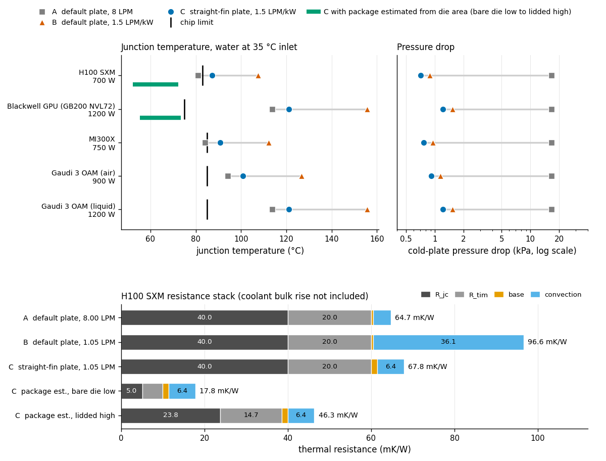

# Model fidelity results: reference case

What the model fidelity track (`docs/work-plan.md`) changed, and what the public chips look like
at a realistic flow per kW once it has. Every number below is printed by
`python examples/reference_case.py`; the figures are drawn by `python examples/make_figures.py`.
These are screening estimates from a 1D model, not measured results.

## What was wrong

Two issues in the convection model, both fixed before this rerun:

- **Circular-tube laminar constants (P1, P2; pull requests 56 and 57).** Laminar flow used
  Nu = 4.36 and f·Re = 64, the values for a round tube, at every channel aspect ratio. Both channel
  models now use the Shah & London (1978) rectangular-duct forms at the channel aspect ratio
  (for a square channel, Nu 3.608 and f·Re 56.908).
- **No fin efficiency (P1).** The default `full_wetted_area` model treats the whole wetted
  perimeter as if it were at base temperature. The optional `straight_fin` model treats the walls
  between channels as fins with adiabatic-tip efficiency and an adiabatic cover
  (`docs/physics.md` Section I).

## Reference case

Water at 35 °C inlet, default package resistances (`R_jc` 0.04 K/W, `R_tim` 0.02 K/W), chip limits
and TDP from `examples/real_chip_benchmarks.py` unchanged. The generic 60 mK/W package is kept in
A, B and C as a labelled conservative case, not a vendor value. Three configurations per chip:

- **A:** default plate (40 channels, 1 × 1 × 80 mm), 8 LPM, the repo's historical default flow.
- **B:** default plate at 1.5 LPM per kW of TDP, the reference flow.
- **C:** reference straight-fin plate at the same 1.5 LPM/kW: 76 channels, 0.39 mm wide, 0.39 mm
  fins, 3.75 mm tall, 60 mm long, 2 mm copper base. These dimensions are the screened design from
  the companion `thermal-design-loop` study.

The green bars in the junction-temperature panel are configuration C with the package estimated from
die area (bare die low to lidded high, next section). The bottom two rows of the resistance stack are
H100 configuration C at the low and high ends of that band.

Chip data: H100 700 W is from the NVIDIA H100 product page; its 83 °C limit is a conservative design
value, not vendor-published for SXM (the H100 PCIe product brief gives 87 °C). The Blackwell GPU in
GB200 NVL72 is "configurable up to 1,200 W" per the NVIDIA Blackwell datasheet; its 75 °C is a design
target whose source could not be traced, not a vendor limit. Gaudi 3 liquid 1200 W is from Intel's
Hot Chips 2024 material; Intel's 2025 technical paper states 900 W liquid-cooled. MI300X and Gaudi 3
limits are 85 °C proxies. Sources are listed in the
[package resistance review](research/package-resistance-review.md).

| Chip | TDP (W) | Limit (°C) | Cfg | Flow (LPM) | Tj (°C) | Margin (°C) | ΔP (kPa) | Pump (W) | Re | Regime |
|---|---:|---:|---|---:|---:|---:|---:|---:|---:|---|
| H100 SXM | 700 | 83 | A | 8.00 | 80.9 | 2.1 | 16.59 | 4.423 | 3734 | transitional |
| H100 SXM | 700 | 83 | B | 1.05 | 107.4 | -24.4 | 0.89 | 0.031 | 490 | laminar |
| H100 SXM | 700 | 83 | C | 1.05 | 87.3 | -4.3 | 0.71 | 0.025 | 125 | laminar |
| Blackwell GPU (GB200 NVL72) | 1200 | 75 | A | 8.00 | 113.7 | -38.7 | 16.59 | 4.423 | 3734 | transitional |
| Blackwell GPU (GB200 NVL72) | 1200 | 75 | B | 1.80 | 155.7 | -80.7 | 1.52 | 0.091 | 840 | laminar |
| Blackwell GPU (GB200 NVL72) | 1200 | 75 | C | 1.80 | 121.2 | -46.2 | 1.22 | 0.073 | 214 | laminar |
| MI300X | 750 | 85 | A | 8.00 | 84.2 | 0.8 | 16.59 | 4.423 | 3734 | transitional |
| MI300X | 750 | 85 | B | 1.12 | 112.2 | -27.2 | 0.95 | 0.036 | 525 | laminar |
| MI300X | 750 | 85 | C | 1.12 | 90.7 | -5.7 | 0.76 | 0.029 | 134 | laminar |
| Gaudi 3 OAM (air) | 900 | 85 | A | 8.00 | 94.0 | -9.0 | 16.59 | 4.423 | 3734 | transitional |
| Gaudi 3 OAM (air) | 900 | 85 | B | 1.35 | 126.7 | -41.7 | 1.14 | 0.051 | 630 | laminar |
| Gaudi 3 OAM (air) | 900 | 85 | C | 1.35 | 100.9 | -15.9 | 0.91 | 0.041 | 160 | laminar |
| Gaudi 3 OAM (liquid) | 1200 | 85 | A | 8.00 | 113.7 | -28.7 | 16.59 | 4.423 | 3734 | transitional |
| Gaudi 3 OAM (liquid) | 1200 | 85 | B | 1.80 | 155.7 | -70.7 | 1.52 | 0.091 | 840 | laminar |
| Gaudi 3 OAM (liquid) | 1200 | 85 | C | 1.80 | 121.2 | -36.2 | 1.22 | 0.073 | 214 | laminar |

Minimum flow that meets each chip's limit (margin 0, search 0.2 to 30 LPM):

| Chip | Plate | Minimum flow (LPM) | ΔP at that flow (kPa) | Regime |
|---|---|---:|---:|---|
| H100 SXM | default | 6.607 | 9.58 | transitional |
| H100 SXM | straight-fin | 9.772 | 6.61 | laminar |
| Blackwell GPU (GB200 NVL72) | default | no passing point in 0.2 to 30 LPM | | |
| Blackwell GPU (GB200 NVL72) | straight-fin | no passing point in 0.2 to 30 LPM | | |
| MI300X | default | 7.331 | 12.90 | transitional |
| MI300X | straight-fin | 20.789 | 15.21 | transitional |
| Gaudi 3 OAM (air) | default | no passing point in 0.2 to 30 LPM | | |
| Gaudi 3 OAM (air) | straight-fin | no passing point in 0.2 to 30 LPM | | |
| Gaudi 3 OAM (liquid) | default | no passing point in 0.2 to 30 LPM | | |
| Gaudi 3 OAM (liquid) | straight-fin | no passing point in 0.2 to 30 LPM | | |

H100 resistance stack (mK/W):

| Cfg | R_jc | R_tim | base | convection | total | (R_jc + R_tim) / total | fin efficiency |
|---|---:|---:|---:|---:|---:|---:|---:|
| A | 40.000 | 20.000 | 0.519 | 4.171 | 64.691 | 92.7% | n/a |
| B | 40.000 | 20.000 | 0.519 | 36.067 | 96.586 | 62.1% | n/a |
| C | 40.000 | 20.000 | 1.461 | 6.374 | 67.835 | 88.5% | 0.750 |

### Package band (configuration C)

The generic package, `R_jc + R_tim` = 60 mK/W, is the input the result hangs on, and the
[package resistance review](research/package-resistance-review.md) (sections 1, Q1, Q2 and 3)
finds it 2x to 10x higher than an estimate from die area and published interface data. The
reference case therefore also evaluates configuration C with that estimate for the two chips whose
die area is known, as a band rather than a point:

| Term | Low | High | Basis |
|---|---|---|---|
| Die conduction | 0.5 mm / 122 W/m·K | 0.8 mm / 122 W/m·K | thickness is an assumption; k from the review |
| TIM1, reflowed indium (lidded only) | 0.023 K·cm²/W | 0.05 K·cm²/W | review Q1 |
| Copper lid (lidded only) | 1.5 mm / 385 W/m·K | 3 mm / 385 W/m·K | thickness is an assumption |
| TIM2 | 0.04 K·cm²/W | 0.12 K·cm²/W | phase-change pad to optimized grease |

Bare die: `R_jc` = die, `R_tim` = TIM2. Lidded: `R_jc` = die + TIM1 + lid, `R_tim` = TIM2. Die
areas: H100 8.14 cm² (NVIDIA); Blackwell GPU 15.6 cm², an order-of-magnitude footprint from a
published test-vehicle paper, not a measured die area. 1D conduction over the die area, uniform
power, no hotspot factor. MI300X and Gaudi 3 stay on the generic package because their die area is
not published.

| Chip | Build | R_jc (mK/W) | R_tim (mK/W) | Sum (mK/W) | Tj (°C) | Margin (°C) |
|---|---|---:|---:|---:|---:|---:|
| H100 SXM | bare die, low | 5.035 | 4.914 | 9.949 | 52.25 | 30.75 |
| H100 SXM | bare die, high | 8.056 | 14.742 | 22.798 | 61.24 | 21.76 |
| H100 SXM | lidded, low | 12.647 | 4.914 | 17.561 | 57.58 | 25.42 |
| H100 SXM | lidded, high | 23.771 | 14.742 | 38.513 | 72.24 | 10.76 |
| H100 SXM | generic 60 mK/W | 40.000 | 20.000 | 60.000 | 87.28 | -4.28 |
| Blackwell GPU (GB200 NVL72) | bare die, low | 2.627 | 2.564 | 5.191 | 55.43 | 19.57 |
| Blackwell GPU (GB200 NVL72) | bare die, high | 4.203 | 7.692 | 11.896 | 63.48 | 11.52 |
| Blackwell GPU (GB200 NVL72) | lidded, low | 6.599 | 2.564 | 9.163 | 60.20 | 14.80 |
| Blackwell GPU (GB200 NVL72) | lidded, high | 12.404 | 7.692 | 20.096 | 73.32 | 1.68 |
| Blackwell GPU (GB200 NVL72) | generic 60 mK/W | 40.000 | 20.000 | 60.000 | 121.20 | -46.20 |

This estimate is low confidence on values: no vendor publishes junction-to-case resistance for these
parts, it is not known whether they are lidded or bare die, die and lid thickness are assumptions,
and hotspots are not included (they raise the effective `R_jc`).

### Findings

- **At 1.5 LPM/kW the default plate is on its laminar plateau and every chip is far over its
  limit.** Its convection resistance is 36.067 mK/W at any laminar flow, against 4.171 mK/W at
  8 LPM, and H100 reaches 107.4 °C against an 83 °C limit.
- **With the generic package, no chip meets its limit at 1.5 LPM/kW and 35 °C inlet, even on the
  straight-fin plate.** The plate recovers most of the default plate's deficit at under 1.5 kPa:
  H100 is at 87.3 °C with 0.71 kPa, and the highest pressure drop in configuration C is 1.22 kPa.
  The remaining gap is the package: `R_jc + R_tim` = 60 mK/W is 88.5% of the H100 stack in
  configuration C, against 7.835 mK/W for the plate.
- **With package values estimated from die area and published interface data, H100 and the
  Blackwell GPU plausibly meet their limits on the straight-fin plate.** H100 is at 52.25 to
  72.24 °C against 83 °C; the Blackwell GPU is at 55.43 to 73.32 °C against 75 °C, with 1.68 K
  margin at the lidded high end. This is an estimate with low confidence on values: no vendor
  publishes junction-to-case resistance, it is not known whether the parts are lidded, and hotspots
  are not included.
- **The 1200 W rows cannot pass on any plate with the generic package resistances.** 1200 W through
  60 mK/W is a 72 K rise from the package alone, which puts the junction above both the 75 °C and
  85 °C limits at 35 °C inlet before the plate or the coolant adds anything. The band above shows
  this is a statement about the generic resistances, not about whether the parts can be cooled.
  Gaudi 3 has no die-area estimate, so its rows stay on the generic package only.
- **The default plate reaches H100's limit at a lower flow than the straight-fin plate only by
  entering the unvalidated transition blend.** Its minimum flow, 6.607 LPM, is in the transitional
  regime; on its laminar plateau it stays over the limit. With the generic package, the straight-fin
  plate reaches the limit at 9.772 LPM while still laminar.

## What did not move, and why

- **Configuration A is the same for every chip in pressure drop and Reynolds number** (16.59 kPa,
  Re 3734), because the flow is fixed at 8 LPM on the same plate and, with fixed properties, the
  hydraulics do not depend on heat load.
- **Junction temperature moves less than pressure drop and required flow.** The package resistances
  (60 mK/W) dominate the stack in A and C, and the coolant-side fixes do not touch them.
- **Chip TDP and limit values are unchanged.** P4b relabelled the 1200 W row as the Blackwell GPU
  (GB200 NVL72) and corrected the source strings; `examples/real_chip_benchmarks.py` keeps its 1 to
  100 LPM searches on the default plate.
- **`src/`, defaults and the generic package are unchanged.** The package band lives in
  `examples/reference_case.py` only.

## What is still unvalidated

- **Transition blend.** Configuration A at 8 LPM and every default-plate minimum flow sit in the
  linear Re 2300 to 4000 blend, which is a numerical interpolation, not an experimentally validated
  transition model. The MI300X straight-fin minimum flow is also above Re 2300, outside the laminar
  range the straight-fin model was checked for.
- **Fixed 25 °C properties.** Temperature-dependent coolant properties (P3) are deferred, so every
  result at 35 °C inlet uses 25 °C water properties and carries that warning.
- **Package resistances.** The generic `R_jc` 0.04 K/W and `R_tim` 0.02 K/W are the same for every
  chip and are not vendor values. The die-area band is an estimate, not a measurement: no vendor
  publishes junction-to-case resistance for these parts, lidded or bare die is not known, die and lid
  thickness are assumed, and hotspots are not included. MI300X and Gaudi 3 have no band because
  their die area is not published.
- **Chip limits.** None of the junction limits is a vendor-published value for that SKU (review Q3).
- **No measured plate.** Neither plate is compared with measured data here; the straight-fin
  equations are checked against the `thermal-design-loop` implementation and a hand calculation only.

## Next steps

- **Area-specific package inputs (deferred option).** Optional `die_area_m2` and area-specific
  `R_jc` / `R_tim` fields, described in the review section 3.3; not implemented.
- **P3:** temperature-dependent coolant properties, deferred by the owner until after the demo.
- **P5:** comparison of the straight-fin model with a measured skived plate (Ortega et al., 2022).
- **Milestone 2:** constrained hydraulic sizing, built on these numbers.
