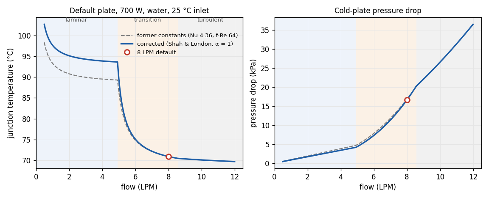
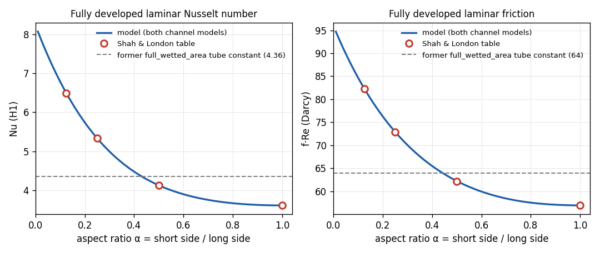

# Physics Model and Assumptions

## A) Overview
The model is a steady-state, 1D thermal resistance network for rapid, first-pass
design analysis. It combines conservation relationships with reduced-order
internal-flow correlations and caller-supplied package/interface resistances.
The equations and software behavior have hand-calculation and regression tests,
but the repository does not contain measured cold-plate or rack data. Those tests
verify implementation and aggregation; they do not establish predictive accuracy
for a particular hardware design.

Thermal path:
`Junction -> Case -> TIM -> Base conduction -> Convection to coolant`

The coolant carries the heat downstream through its bulk temperature rise.
`ambient_temp_c` is a legacy reserved input, not a heat-rejection term in these
equations. The model does not solve heat transfer from coolant to room air.

## B) Equations used
- Reynolds number:
  - `Re = rho * v * Dh / mu`
- Prandtl number:
  - `Pr = cp * mu / k`
- Nusselt number:
  - Laminar (`Re < 2300`): `Nu = Nu_H1(alpha)`, the Shah & London fully developed
    rectangular-duct value (H1 boundary condition, four walls heated) at
    `alpha = min(w, h) / max(w, h)`; polynomial in Section I. `Nu = 3.610` for the
    default square channel (`alpha = 1`).
  - Turbulent (`Re > 4000`): `Nu = 0.023 * Re^0.8 * Pr^0.4` (Dittus–Boelter)
  - Transitional: linear blend between laminar and turbulent endpoints for numerical continuity during optimization; this blend is not an experimentally validated transition correlation.
- Convection coefficient:
  - `h = Nu * k / Dh`
- Convection resistance:
  - `R_conv = 1 / (h * A_wetted)`
- Base conduction resistance:
  - `R_base = t_base / (k_cu * A_contact)`
- Total thermal resistance:
  - `R_total = R_jc + R_tim + R_base + R_conv`
- Coolant bulk rise:
  - `deltaT_coolant = Q / (m_dot * cp)`
- Junction temperature:
  - `Tj = Tin + 0.5*deltaT_coolant + Q*R_total`
- Pressure drop (Darcy–Weisbach):
  - `deltaP = f * (L/Dh) * (rho * v^2 / 2)`
  - Laminar `f = (f Re)_Darcy(alpha) / Re` (Shah & London, Section I;
    `(f Re)_Darcy = 56.92` for `alpha = 1`), turbulent `f = 0.3164*Re^-0.25`
    (Blasius smooth-pipe)

## C) Correlations and regime logic
- Reynolds number determines regime:
  - `<2300`: laminar
  - `2300-4000`: transitional (explicit blend for numerical smoothness)
  - `>4000`: turbulent
- Both Nusselt number and friction factor are linearly blended in the transition regime (Re 2300–4000) to avoid discontinuities. The friction factor blends between the laminar value at Re=2300 (`(f Re)_Darcy(alpha) / 2300`, `56.9184 / 2300 ≈ 0.0247` for the default square channel) and the Blasius turbulent value at Re=4000 (`0.3164 × 4000^−0.25 ≈ 0.0398`), matching the Nusselt number treatment; the Nusselt number blends from `Nu_H1(alpha)` to Dittus–Boelter at Re=4000. The blend provides numerical continuity only; it is not evidence that transition behavior is accurate for the specified channel.
- The laminar rectangular-duct values and turbulent Dittus–Boelter expression are first-pass approximations. They do not by themselves establish accuracy for arbitrary rectangular channels, heating boundaries other than H1, entrance lengths, or developing flow, and the transition blend and turbulent closures do not depend on aspect ratio. The [F-Chart/EES rectangular-duct reference](https://fchart.com/ees/heat_transfer_library/internal_flow/hs1122.htm) illustrates why those factors affect rectangular-channel correlations. The current implementation does not model those corrections or enforce a correlation-specific validity range.
- The official [EES rectangular-duct documentation](https://fchart.com/ees/heat_transfer_library/internal_flow/hs1120.htm) requires aspect ratio, length/hydraulic-diameter ratio, relative roughness, wall boundary condition, and developing-flow treatment. Its [laminar duct documentation](https://fchart.com/ees/heat_transfer_library/internal_flow/hs1122.htm) expects `Re < 2300` and bulk-average properties. The [turbulent pipe documentation](https://fchart.com/ees/heat_transfer_library/internal_flow/hs1022.htm) likewise includes length/diameter, roughness, and developing-flow effects. These pages provide validity context for the named closures; they do not validate this implementation for arbitrary cold-plate geometry, roughness, entrance effects, or manifolds.
- Change note (2026-11-17): until this change the `full_wetted_area` path used the
  circular-tube constants `Nu = 4.36` and Darcy `f·Re = 64` for every channel shape.
  Those are the fully developed values for a round tube under uniform heat flux,
  not for a rectangular duct. The path now uses the Shah & London (1978)
  rectangular-duct forms already used by the straight-fin model (Section I, same
  source note), evaluated at the channel aspect ratio. The H1 four-wall form
  matches a path that heats the full wetted perimeter. Nothing else about the path
  changed: full wetted perimeter as heated area, no fin efficiency, the
  2300–4000 blend, Dittus–Boelter and Blasius above it. For the default square
  channel, laminar `Nu` falls from 4.36 to 3.610 and laminar `f·Re` from 64 to
  56.92, so laminar junction temperatures rise (700 W, 4 LPM: 89.53 → 93.87 °C)
  and laminar pressure drops fall (3.797 → 3.377 kPa); the default 8 LPM
  transitional case moves from 70.902 to 70.913 °C and 16.800 to 16.587 kPa;
  fully turbulent points do not move. The figure below compares the two.

  

  *Generated by `examples/make_figures.py`.*
- Pump power is computed as `ΔP × Q / η` with η = 0.50. This is a fixed illustrative assumption, not a pump curve or system operating-point calculation.

## D) Parameters and defaults
- Heat load: `700 W`
- Flow: `8 L/min`
- Inlet temp: `25 C`
- Ambient reference: `25 C`
- `R_jc = 0.04 K/W`, `R_tim = 0.02 K/W`
- Geometry defaults:
  - `channel_count=40`
  - `Dh=1.0 mm`
  - `L=80 mm`
  - `channel_width=1.0 mm`
  - `base_thickness=2.0 mm`
  - `contact_area=0.01 m^2`
  - `k_copper=385 W/m-K`

Coolant table (fixed nominal properties at a 25°C reference point):
- Water: `rho=997 kg/m3`, `cp=4180 J/kg-K`, `k=0.60 W/m-K`, `mu=0.00089 Pa*s`
- Ethylene glycol 50% (by volume): `rho=1060 kg/m3`, `cp=3400 J/kg-K`, `k=0.40 W/m-K`, `mu=0.0048 Pa*s`.

These values are held constant during a run. They are not a temperature lookup,
and the model does not infer whether they remain suitable at the caller's inlet,
bulk, or outlet temperature. A result outside the nominal property point must be
treated as a scenario with unquantified property error.

## E) Limitations and validity boundary
- No manifold/header loss model, channel maldistribution, or branch-to-branch flow tolerance.
- No boiling/two-phase behavior.
- No transient thermal capacitance.
- No explicit 2D/3D spreading resistance in the substrate, base, package, or die.
- Constant properties (no temperature-dependent fluid properties).
- `A_wetted` is the full channel wetted perimeter times channel length. It is an
  effective heated-area assumption, not a claim that every wetted wall is heated
  uniformly. Fin efficiency, conjugate conduction, entrance effects, and the
  actual heat-source footprint are not modeled.
- Laminar `Nu` and `f·Re` are fully developed rectangular-duct values for the H1
  boundary condition (all four walls heated). Developing flow, other heating
  boundaries (for example one heated wall), and aspect-ratio effects on the
  transition and turbulent closures are not modeled.
- Geometry fields are algebraically valid inputs, not a guarantee that a physical
  cold plate can be manufactured or that the selected correlation applies.
- An optional `straight_fin` channel model with aspect-ratio laminar correlations
  and fin efficiency is described in Section I; the bullets above describe the
  default `full_wetted_area` model.

The model is suitable for transparent, conditional architecture screening when
the caller supplies credible component inputs. It is not validated for hardware
signoff, local hotspot prediction, complete CDU sizing, or any result that
depends materially on the omitted effects above.

## F) Engineering Notes
This model uses Dittus-Boelter for turbulent forced convection and the fully developed laminar rectangular-duct Nusselt number at the channel aspect ratio for low-Re flow. These are reduced-order approximations selected for a transparent first-pass model; their use here is not a validation claim for arbitrary rectangular cold plates. Transitional flow is blended linearly to avoid discontinuities in optimization.

Failure modes not captured: flow maldistribution across channels, 2D/3D spreading resistance in package and base, contact-resistance scatter, TIM pump-out/aging, manifold/header losses, air ingestion, boiling inception, and transient warm-up behavior.

For a future hardware validation, collect: flow rate, inlet/outlet coolant temperatures, multiple base temperatures, pressure drop across the cold plate and relevant assembly, and electrical heat input. Then compare inferred thermal-resistance and pressure-drop curves versus model predictions at stated reference conditions. No such measured dataset is included in this repository today.

Potential future enhancements:
1. Temperature-dependent coolant properties and viscosity correction.
2. Explicit manifold + entrance/exit minor-loss coefficients.
3. Package/base spreading-resistance submodel.
4. Transient RC network for warm-up and control studies.
5. Calibrated contact/TIM resistance distributions (not single deterministic value).
6. Optional uncertainty propagation (Monte Carlo on key inputs).

## G) Rack-level model

`analyze_rack()` extends the single-plate model to N identical GPU cold plates
plumbed in series or parallel. Added 2026-03-06.

### Series topology

CDU supply flows through each cold plate in sequence. The outlet of GPU `i`
becomes the inlet of GPU `i+1`:

```
T_in[0] = T_cdu_supply
T_in[i] = T_in[i-1] + coolant_rise[i-1]
Tj[i]   = (T_in[i] + 0.5 × coolant_rise) + Q × R_total
```

Because fluid properties are constant (no temperature dependence), `coolant_rise`
and `R_total` are the same for every GPU. Therefore:

```
Tj[i+1] - Tj[i] = coolant_rise   (exact)
```

The last GPU is always the hottest. Total pressure drop:

```
ΔP_total = N × ΔP_single
```

This is exact: all cold plates see the same flow and geometry, so each ΔP is
identical. CDU outlet temperature:

```
T_cdu_out = T_cdu_supply + N × coolant_rise
```

### Parallel topology

CDU supply splits equally across all cold plates. Flow per GPU:

```
Q_per_gpu = Q_total / N
```

All GPUs share the same inlet (CDU supply temperature) and are hydraulically
identical. System pressure drop equals the branch pressure drop:

```
ΔP_total = ΔP_single(Q_per_gpu)
```

CDU outlet from an energy balance over the full rack:

```
T_cdu_out = T_cdu_supply + Q_rack_total / (m_dot_total × cp)
```

where `m_dot_total = (Q_total / 60000) × ρ`.

### Pump power

Same 50% efficiency assumption as the single-plate model:

```
P_pump = ΔP_total × (Q_total / 60000) / 0.50
```

### Assumptions and limitations

- **Ambient reference handling:** `ambient_temp_c` is optional for rack inputs.
  If omitted, rack analysis defaults ambient reference to `T_cdu_supply` when
  constructing per-GPU cold plate analyses.
- **Identical GPUs:** All cold plates have the same TDP, geometry, and thermal
  resistances. Heterogeneous racks (mix of GPU types) are not supported.
- **Uniform flow distribution:** No maldistribution between parallel branches.
  The model does not provide an empirical bound for local flow variation.
- **No manifold or header losses:** Only cold-plate ΔP is modeled. The actual
  non-plate loss is unknown to this model and must be supplied or measured before
  a rack-level hydraulic requirement is treated as complete.
- **Constant fluid properties:** The same fixed-25°C reference properties are
  used for every GPU in the rack. The repository does not establish an error
  bound at other temperatures.

### Validation

Two hand-calc tests in `tests/test_physics_behavior.py`:
- `test_rack_series_two_gpu_hand_calc`: Verifies GPU 0 = standalone analysis,
  GPU 1 = GPU 0 + coolant_rise, CDU outlet, and total ΔP for 2-GPU series case.
- `test_rack_parallel_two_gpu_hand_calc`: Verifies all GPUs = standalone at
  per-GPU flow, total ΔP = single-plate ΔP, CDU outlet from energy balance.

---

## Section H: Sensitivity and Uncertainty Analysis

### Motivation

The 1D resistance model produces a single point estimate for `junction_temp_c`.
That estimate should be read as conditional on the supplied inputs and model
assumptions. The `compute_sensitivity()` function exposes illustrative
perturbations through `sensitivity=True` on the `analyze_coldplate` tool. These
perturbations are not measured distributions, manufacturing tolerances, field
service predictions, or lifecycle forecasts.

Current illustrative perturbations are:

- `R_jc`: a centered ±20% change.
- `R_tim`: a doubled value.
- Heat load: a small positive perturbation used to report `∂Tj/∂Q`.

The current helper applies these fixed perturbations. A caller making a hardware
decision must run separate scenarios with evidence-backed bounds outside this
helper. A perturbation result is a model delta, not an implied probability or
service-life expectation.

### Finite-difference scheme

All derivatives use forward differences with step sizes chosen to be small
relative to operating ranges while avoiding floating-point cancellation:

| Parameter | Step | Notes |
|-----------|------|-------|
| Q_heat    | max(1% × Q, 1 W) | Linear regime; forward diff exact |
| R_tim     | max(1% × R_tim, 1e-4 K/W) | Linear regime; forward diff exact |
| T_inlet   | 0.1°C | Forward diff; should return exactly 1.0 |
| R_jc      | ±20% (centered) | Illustrative perturbation, not an uncertainty bound |
| R_tim_aged | R_tim × 2.0 | Illustrative scenario, not a field-degradation prediction |

### Analytical verification

Because the model is linear in Q, R_tim, and T_inlet at fixed flow:

```
Tj = T_inlet + 0.5 × Q/(m_dot × cp) + Q × R_total

∂Tj/∂Q        = (Tj - T_inlet) / Q               [°C/W]
∂Tj/∂R_tim    = Q                                  [°C per K/W]
∂Tj/∂T_inlet  = 1.0                               [dimensionless, exact]
```

The finite-difference tests in `test_sensitivity_*` confirm numerical results
match these analytical values to < 0.01°C tolerance.

### margin_c in optimize_flow_rate

The `margin_c` parameter shifts the optimizer's effective target:

```
effective_target = max_junction_temp_c - margin_c
```

No universal margin is recommended by this model. A caller may use `margin_c` to
encode an externally justified guardband, but the value must reflect the actual
package, TIM, operating, and measurement evidence for the design. Setting
`margin_c=0` (default) reproduces legacy behavior exactly; it does not mean that
zero engineering margin is safe.

---

## Section I: Straight-fin channel model

Selected with `geometry.channel_model = "straight_fin"` and a required
`geometry.fin_thickness_m`. The default, `"full_wetted_area"`, is the model in
Sections B, C and E. Added 2026-11-15. Since 2026-11-17 the `full_wetted_area`
path uses the same laminar correlations below (Section C change note); the two
models now differ only in the heated area and fin efficiency.

### Geometry

The walls between channels are treated as straight rectangular fins rising from
the base. With channel width `w`, channel height `H` (= fin height), fin
thickness `t`, channel count `N` and flow length `L`:

```
alpha = min(w, H) / max(w, H)          aspect ratio, 0 < alpha <= 1
Dh    = 2 w H / (w + H)                 unchanged
A_flow = N w H                          unchanged; t does not enter the hydraulics
```

Fins use `copper_k_w_mk`, the same conductivity as the base. `R_base` still uses
`contact_area_m2`, coolant rise, `Tj` and pump power are as in Section B.

### Correlations (fully developed laminar flow)

Shah & London (1978) polynomial fits for rectangular ducts, H1 boundary
condition (axially uniform heat flux, peripherally uniform wall temperature, all
four walls heated):

```
Nu_lam(alpha)       = 8.235 (1 - 2.0421 a + 3.0853 a^2 - 2.4765 a^3 + 1.0578 a^4 - 0.1861 a^5)
(f Re)_Darcy(alpha) =    96 (1 - 1.3553 a + 1.9467 a^2 - 1.7012 a^3 + 0.9564 a^4 - 0.2537 a^5)
```

The Darcy form is four times the Fanning form `24 (1 - 1.3553 a + ...)`. Against
the tabulated values below, the polynomials agree within 0.07 % (test
`test_straight_fin_correlations_match_shah_london_table`, tolerance 0.5 %):

| alpha | f·Re Fanning | f·Re Darcy | Nu (H1) |
|---|---|---|---|
| 1.0 | 14.227 | 56.908 | 3.608 |
| 0.5 | 15.548 | 62.192 | 4.123 |
| 0.25 | 18.233 | 72.932 | 5.331 |
| 0.125 | 20.585 | 82.340 | 6.490 |

Both are symmetric in `w` and `H` because they depend on `alpha` only.



*Generated by `examples/make_figures.py`.*

### Convection resistance with fin efficiency

```
h     = Nu k_f / Dh
m     = sqrt(2 h / (k_s t))
eta   = tanh(m H) / (m H)                 adiabatic fin tip
R_conv = 1 / (N L h (w + 2 eta H))
```

Per channel, the floor (width `w`) is taken at `eta = 1`, the two fin sides
(height `H` each) at `eta`, and the cover is adiabatic: a lid bonded to the fin
tips is assumed to carry no heat. As `k_s → ∞`, `eta → 1` and
`R_conv → 1 / (N L h (w + 2H))`. `fin_efficiency` is reported in the output.

The `full_wetted_area` model, by contrast, uses `R_conv = 1 / (h · N · 2(w + H) · L)`
with the same `Nu_lam(alpha)`: all four walls at full effectiveness, including the
cover.

### Pressure drop

`ΔP = f (L / Dh) (ρ v² / 2)` with `f = (f Re)_Darcy(alpha) / Re` for `Re < 2300`.

### Regime handling

- `Re < 2300`: the laminar forms above.
- `Re ≥ 2300`: the existing transition blend (Section C) and turbulent closures
  (Dittus–Boelter, Blasius) are kept, with the laminar end of the blend set to
  `Nu_lam(alpha)` and `(f Re)_Darcy(alpha) / 2300`; `eta` is computed from the
  resulting `h`. Nu and `f` are continuous at Re = 2300 and Re = 4000. This range
  was not part of the CFD comparison of the reference implementation, so the
  output carries the warning "straight-fin correlations were checked for laminar
  flow only; this operating point is outside that range".

### Evidence

- The equations are ported from `tools/screen_1d.py` in the sibling repository
  `thermal-design-loop` (commit `189f017`), whose 1D thermal resistance is
  reported to agree with conjugate CFD to 1.0 % on average, for laminar designs.
  That CFD comparison lives in that repository and is not reproduced here.
- `test_straight_fin_reproduces_screen_1d` reproduces `analyze_1d` at that commit
  for a 76-channel, 0.39 / 0.39 / 3.75 mm design at 1000 W and 1.5 LPM (water and
  glycol50, this repository's coolant constants) within 1e-6 relative.
- `test_hand_calc_validation_straight_fin_800w_water` is an independent hand
  calculation on a different geometry (alpha = 0.4).
- No measured cold-plate data is included; the "no measured cold-plate
  validation" warning stays on this path.

Source note: the polynomial coefficients were taken from the reference
implementation and the tabulated values from the P1 brief, both attributed to
R. K. Shah and A. L. London, *Laminar Flow Forced Convection in Ducts*, Advances
in Heat Transfer Supplement 1, Academic Press, 1978. The primary source was not
read in full text for this change.

### What it still omits

- Entrance (developing-flow) effects: fully developed Nu and f·Re are applied
  over the whole length, which underestimates heat transfer and pressure drop in
  short channels.
- Heat transfer from the fin tips and through the cover.
- Flow maldistribution across channels, and manifold, inlet and outlet losses.
- 2D spreading in the base and the actual heat-source footprint: `R_base` uses
  `contact_area_m2` as a 1D area.
- Temperature-dependent properties (Section D) and conjugate effects beyond the
  1D fin.
- Manufacturability and footprint checks: `N (w + t)` is not compared with
  `contact_area_m2` or any plate width, and minimum feature size or fin aspect
  ratio is not enforced.

Every straight-fin result carries the warning "straight-fin model assumes fully
developed laminar flow with an adiabatic cover; entrance effects, fin-tip heat
transfer and flow maldistribution are not modeled", in place of the
full_wetted_area warning about rectangular-channel correlations and effective
heated area.
